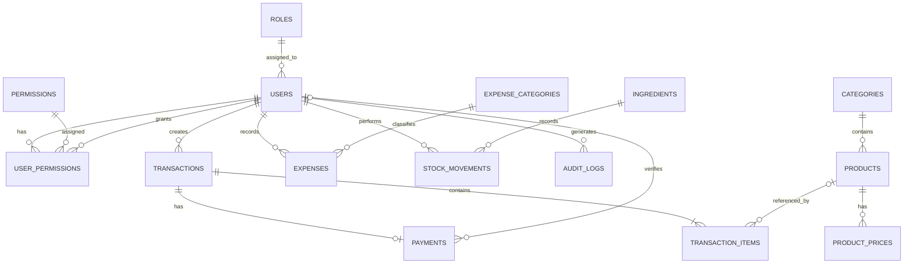

# LABOR_STATION — Database Design

## 1. Overview

LABOR_STATION menggunakan PostgreSQL sebagai sistem manajemen basis data.

Struktur database dikelola menggunakan Laravel Migrations. Database dirancang untuk mendukung pengelolaan pengguna, produk, persediaan, transaksi penjualan, pembayaran, pengeluaran, dan pencatatan aktivitas.

## 2. Database Technology

| Property | Configuration |
|---|---|
| DBMS | PostgreSQL |
| Database | labor_station |
| Default Local Host | 127.0.0.1 |
| Default Local Port | 5433 |
| ORM | Laravel Eloquent |
| Schema Management | Laravel Migrations |

## 3. Database Tables

Database terdiri dari tabel-tabel berikut.

### 3.1 User Management

| Table | Description |
|---|---|
| users | Menyimpan informasi pengguna |
| roles | Menyimpan jenis peran pengguna |
| permissions | Menyimpan daftar hak akses |
| user_permissions | Menghubungkan pengguna dengan permission |
| personal_access_tokens | Menyimpan token autentikasi Sanctum |

**users**
- id (PK)
- role_id (FK, nullable)
- name
- email (unique)
- email_verified_at
- password
- remember_token
- created_at
- updated_at

**roles**
- id (PK)
- name (unique)
- slug (unique)
- created_at
- updated_at

**permissions**
- id (PK)
- name
- slug (unique)
- description
- created_at
- updated_at

**user_permissions**
- id (PK)
- user_id (FK)
- permission_id (FK)
- granted_by (FK, nullable)
- created_at
- updated_at

### 3.2 Product Management

| Table | Description |
|---|---|
| categories | Kategori produk |
| products | Informasi produk |
| product_prices | Harga produk berdasarkan kanal penjualan |

**categories**
- id (PK)
- name (unique)
- slug (unique)
- description
- is_active
- created_at
- updated_at

**products**
- id (PK)
- category_id (FK)
- name
- slug (unique)
- sku (nullable, unique)
- description
- image_path
- temperature_options (JSON, nullable)
- is_active
- offline_status
- grabfood_status
- created_at
- updated_at
- deleted_at

**product_prices**
- id (PK)
- product_id (FK)
- sales_channel
- price
- is_active
- created_at
- updated_at

Constraint:
- Kombinasi `product_id` dan `sales_channel` bersifat unique.

Dengan demikian, satu produk dapat memiliki harga berbeda berdasarkan kanal penjualan tanpa harus dibuat menjadi dua produk terpisah.

### 3.3 Inventory Management

| Table | Description |
|---|---|
| ingredients | Data bahan baku |
| stock_movements | Riwayat perubahan stok bahan baku |

**ingredients**
- id (PK)
- name (unique)
- unit
- current_stock
- minimum_stock
- is_active
- created_at
- updated_at

**stock_movements**
- id (PK)
- ingredient_id (FK)
- user_id (FK)
- type
- quantity
- stock_before
- stock_after
- reason
- movement_at
- created_at
- updated_at

### 3.4 Transaction Management

| Table | Description |
|---|---|
| transactions | Data transaksi penjualan |
| transaction_items | Detail item transaksi |
| payments | Data pembayaran |

**transactions**
- id (PK)
- invoice_number (unique)
- user_id (FK)
- customer_name (nullable)
- sales_channel
- order_status
- payment_status
- subtotal
- discount
- total
- notes (nullable)
- completed_at (nullable)
- cancelled_at (nullable)
- platform_deduction (nullable)
- net_payout (nullable)
- payout_status (nullable)
- payout_date (nullable)
- created_at
- updated_at

**transaction_items**
- id (PK)
- transaction_id (FK)
- product_id (FK, nullable)
- item_type
- product_name_snapshot
- unit_price
- quantity
- subtotal
- temperature (nullable)
- created_at
- updated_at

Catatan:
- `product_id` dapat bernilai NULL untuk mendukung item manual.
- `product_name_snapshot` menyimpan nama produk pada saat transaksi.
- `temperature` menyimpan pilihan persiapan minuman, seperti Hot atau Iced.
- `item_type` memiliki nilai default `CATALOG`.

**payments**
- id (PK)
- transaction_id (FK, unique)
- verified_by (FK, nullable)
- method
- amount
- reference_number (nullable)
- paid_at (nullable)
- created_at
- updated_at

Constraint:
- `transaction_id` pada payments bersifat unique sehingga satu transaksi hanya memiliki satu record pembayaran berdasarkan struktur migration saat ini.

### 3.5 Expense Management

| Table | Description |
|---|---|
| expense_categories | Kategori pengeluaran |
| expenses | Data pengeluaran |

**expense_categories**
- id (PK)
- name (unique)
- slug (unique)
- description (nullable)
- is_active
- created_at
- updated_at

**expenses**
- id (PK)
- expense_category_id (FK)
- user_id (FK)
- description
- amount
- expense_date
- notes (nullable)
- created_at
- updated_at

### 3.6 Audit Management

**audit_logs**
- id (PK)
- user_id (FK, nullable)
- action
- entity_type
- entity_id (nullable)
- metadata (JSONB, nullable)
- created_at

Tabel ini digunakan untuk mencatat aktivitas sistem yang relevan.

`entity_type` dan `entity_id` menyimpan referensi entitas yang dicatat tanpa foreign key langsung ke tabel tertentu.

## 4. Entity Relationship Diagram (ERD)

Diagram berikut menggambarkan relasi berdasarkan foreign key yang didefinisikan dalam migration.

## 5. Relationship Description

| Relationship | Cardinality | Description |
|---|---|---|
| Roles - Users | 1:N | Satu role dapat digunakan banyak pengguna |
| Users - User Permissions | 1:N | Pengguna dapat memiliki beberapa permission |
| Permissions - User Permissions | 1:N | Permission dapat diberikan kepada banyak pengguna |
| Categories - Products | 1:N | Satu kategori memiliki banyak produk |
| Products - Product Prices | 1:N | Produk memiliki harga berdasarkan kanal |
| Ingredients - Stock Movements | 1:N | Bahan baku memiliki riwayat perubahan stok |
| Users - Stock Movements | 1:N | Pengguna melakukan perubahan stok |
| Users - Transactions | 1:N | Pengguna membuat transaksi |
| Transactions - Transaction Items | 1:N | Transaksi memiliki detail item |
| Products - Transaction Items | 1:N | Produk dapat direferensikan oleh item transaksi |
| Transactions - Payments | 1:0..1 | Transaksi memiliki maksimal satu record pembayaran |
| Expense Categories - Expenses | 1:N | Kategori memiliki banyak pengeluaran |
| Users - Expenses | 1:N | Pengguna mencatat pengeluaran |
| Users - Audit Logs | 1:N | Pengguna dapat terkait dengan banyak audit log |

## 6. Important Database Constraints

Beberapa constraint yang diterapkan pada database:

- Email pengguna harus unique.
- Role name dan slug harus unique.
- Permission slug harus unique.
- Nama dan slug kategori harus unique.
- Slug dan SKU produk memiliki constraint unique.
- Kombinasi produk dan kanal penjualan pada `product_prices` harus unique.
- Invoice number transaksi harus unique.
- Satu transaksi hanya memiliki satu record pembayaran.
- Kombinasi user dan permission pada `user_permissions` harus unique.
- Foreign key tertentu menggunakan `restrictOnDelete`, `cascadeOnDelete`, atau `nullOnDelete` sesuai kebutuhan relasi.

## 7. Special Business Rules

### 7.1 Sales Channel Pricing

Produk menggunakan satu identitas produk dengan harga yang disimpan berdasarkan kanal penjualan.

Kanal yang didukung:
- OFFLINE
- GRABFOOD

Harga disimpan pada tabel `product_prices`.

### 7.2 Product Availability

Tabel `products` menyediakan:
- `offline_status`
- `grabfood_status`

Kedua kolom digunakan untuk menyimpan status ketersediaan produk pada masing-masing kanal.

### 7.3 Temperature Options

Produk dapat menyimpan pilihan temperatur melalui `temperature_options`.

Pilihan temperatur transaksi disimpan pada kolom `temperature` di `transaction_items`.

### 7.4 GrabFood Payout

Informasi pencairan GrabFood disimpan pada tabel `transactions` melalui:
- `platform_deduction`
- `net_payout`
- `payout_status`
- `payout_date`

### 7.5 Manual Transaction Items

Kolom `product_id` pada `transaction_items` bersifat nullable.

Hal ini memungkinkan transaksi menyimpan item manual yang tidak terhubung langsung dengan katalog produk.

## 8. Laravel Support Tables

Selain tabel bisnis, migration Laravel juga membuat tabel pendukung:

| Table | Purpose |
|---|---|
| password_reset_tokens | Token reset password |
| sessions | Data sesi |
| cache | Penyimpanan cache |
| cache_locks | Penguncian cache |
| jobs | Antrean pekerjaan |
| job_batches | Kelompok pekerjaan |
| failed_jobs | Pekerjaan yang gagal |
| personal_access_tokens | Token autentikasi Sanctum |

## 9. Referential Integrity

Relasi database menggunakan foreign key untuk menjaga konsistensi data.

Beberapa kebijakan penghapusan yang diterapkan:
- `restrictOnDelete`: mencegah penghapusan data induk ketika masih direferensikan.
- `cascadeOnDelete`: menghapus data terkait ketika data induk dihapus.
- `nullOnDelete`: mengubah foreign key menjadi NULL ketika data induk dihapus.

## 10. Documentation Notes

Dokumentasi ini disusun berdasarkan migration Laravel yang tersedia pada saat pemeriksaan.

Nama kolom, tipe data, constraint, dan relasi mengikuti definisi migration.

Diagram ERD hanya menggambarkan relasi foreign key yang teridentifikasi. Tabel pendukung Laravel dan relasi non-foreign-key tidak seluruhnya ditampilkan pada diagram.

Perubahan migration berikutnya harus diikuti pembaruan dokumen ini.