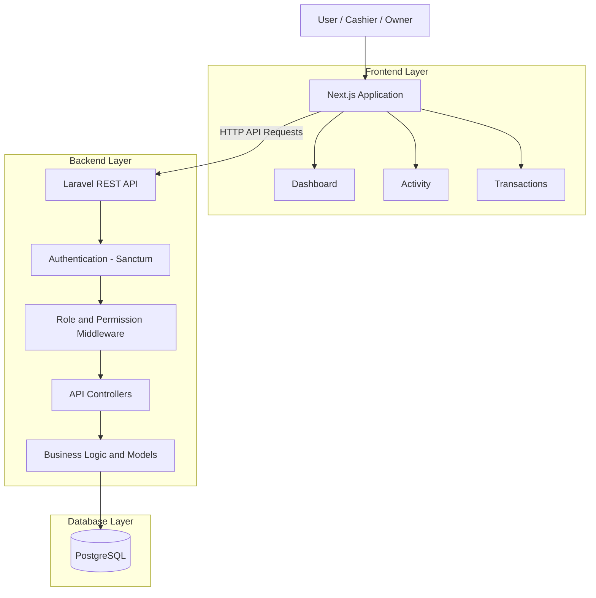
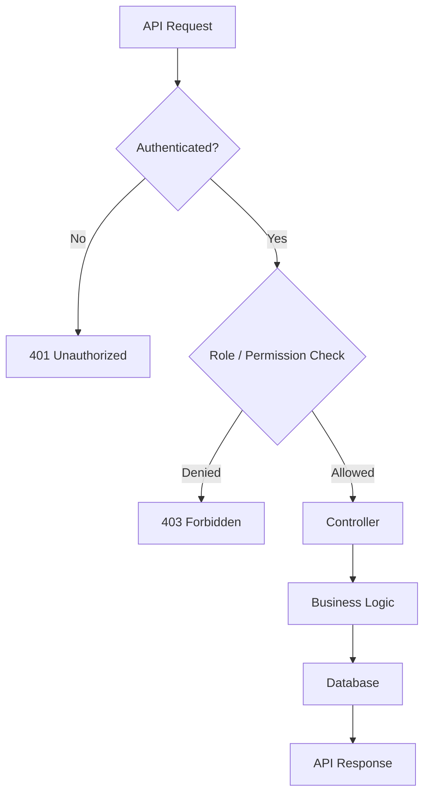

# LABOR_STATION — System Architecture

## 1. Overview

LABOR_STATION merupakan aplikasi Point of Sale (POS) dengan arsitektur monorepo yang memisahkan frontend, backend, dan dokumentasi teknis.

Sistem menggunakan Next.js sebagai frontend, Laravel sebagai backend REST API, dan PostgreSQL sebagai sistem manajemen basis data.

Arsitektur ini memisahkan antarmuka pengguna dari proses bisnis dan penyimpanan data sehingga setiap komponen dapat dikembangkan dan dipelihara secara terstruktur.

## 2. Technology Architecture

| Layer | Technology | Responsibility |
|---|---|---|
| Frontend | Next.js 16.4.6 | Antarmuka pengguna |
| UI Library | React 19.3.0 | Komponen antarmuka |
| Programming Language | TypeScript | Pengembangan frontend |
| Styling | Tailwind CSS 4.3.3 | Tampilan aplikasi |
| Backend | Laravel 13 | Business logic dan REST API |
| Authentication | Laravel Sanctum 4 | Autentikasi API |
| Database | PostgreSQL | Penyimpanan data |
| Dependency Management | npm dan Composer | Pengelolaan dependensi |

## 3. High-Level Architecture



## 4. Frontend Architecture

Frontend berada di direktori `frontend/` dan dikembangkan menggunakan Next.js App Router.

Struktur halaman yang teridentifikasi:

```text
frontend/
└── src/
    └── app/
        ├── layout.tsx
        ├── page.tsx
        ├── globals.css
        └── dashboard/
            ├── page.tsx
            ├── activity/
            │   └── page.tsx
            └── transactions/
                └── page.tsx
```

### Frontend Responsibilities

- Menyediakan antarmuka pengguna.
- Menampilkan dashboard aplikasi.
- Menampilkan aktivitas sistem.
- Menyediakan halaman transaksi.
- Menangani interaksi pengguna dengan aplikasi.
- Berkomunikasi dengan backend melalui API.

## 5. Backend Architecture

Backend berada di direktori `backend/` dan menggunakan Laravel 13.

Backend bertanggung jawab terhadap:

- Autentikasi pengguna.
- Pengelolaan role dan permission.
- Pengelolaan produk dan kategori.
- Pengelolaan transaksi.
- Pengelolaan pembayaran.
- Pengelolaan pengeluaran.
- Pencatatan audit log.
- Pengelolaan laporan dan dashboard Owner.
- Pengelolaan pencairan pembayaran GrabFood.

### Backend Components

| Component | Responsibility |
|---|---|
| Routes | Mendefinisikan endpoint API |
| Controllers | Menangani request dan response |
| Models | Merepresentasikan entitas database |
| Middleware | Memeriksa autentikasi dan otorisasi |
| Migrations | Mengelola struktur database |

### Main Controllers

- AuthController
- ProductCatalogController
- ProductManagementController
- CategoryController
- TransactionController
- PaymentController
- OrderStatusController
- ExpenseController
- GrabFoodPayoutController
- OwnerDashboardController
- AuditLogController
- UserPermissionController

## 6. Authentication and Authorization

Sistem menggunakan Laravel Sanctum untuk autentikasi API.

Endpoint login dapat diakses tanpa autentikasi, sedangkan endpoint yang dilindungi berada di dalam middleware `auth:sanctum`.

Setelah autentikasi, akses pengguna diperiksa melalui middleware role dan permission.

### Authorization Flow



## 7. Database Architecture

Sistem menggunakan PostgreSQL sebagai database utama.

Database menyimpan informasi yang berkaitan dengan:

- Users dan roles.
- Permissions dan user permissions.
- Categories dan products.
- Product prices.
- Ingredients dan stock movements.
- Transactions dan transaction items.
- Payments.
- Expense categories dan expenses.
- Audit logs.
- Personal access tokens.

Struktur database dikelola menggunakan Laravel migrations.

Detail tabel dan relasi dijelaskan pada dokumen [DATABASE_DESIGN.md](DATABASE_DESIGN.md).

## 8. API Architecture

Backend menyediakan REST API melalui route yang didefinisikan pada:

`backend/routes/api.php`

Endpoint API dikelompokkan berdasarkan fungsi:

- Authentication
- Product Catalog
- Product Management
- Category Management
- Transactions
- Payments
- Order Status
- Expenses
- GrabFood Payout
- Owner Dashboard
- Audit Logs
- User Permissions

Detail endpoint akan dijelaskan pada [API_DOCUMENTATION.md](API_DOCUMENTATION.md).

## 9. Sales Channel Architecture

Sistem mendukung dua kanal penjualan:

1. Offline
2. GrabFood

Harga dan ketersediaan produk dapat dikelola berdasarkan kanal penjualan.

Produk minuman tertentu juga mendukung pilihan temperatur:

- Hot
- Iced

Pilihan temperatur disimpan pada item transaksi sebagai opsi persiapan produk, bukan sebagai produk atau harga terpisah.

## 10. Security Architecture

Pengamanan sistem dilakukan melalui:

- Laravel Sanctum untuk autentikasi API.
- Middleware role untuk pembatasan akses berdasarkan peran.
- Middleware permission untuk pembatasan akses berdasarkan hak pengguna.
- Validasi request pada backend.
- Environment variables untuk konfigurasi sensitif.
- Audit logs untuk pencatatan aktivitas yang relevan.

File environment dan kredensial tidak boleh dimasukkan ke repository.

## 11. Repository Structure

```text
labor-station/
├── frontend/
│   ├── public/
│   └── src/
├── backend/
│   ├── app/
│   ├── bootstrap/
│   ├── config/
│   ├── database/
│   ├── public/
│   ├── resources/
│   ├── routes/
│   ├── storage/
│   └── tests/
├── documentation/
│   ├── README.md
│   ├── SYSTEM_ARCHITECTURE.md
│   ├── DATABASE_DESIGN.md
│   ├── API_DOCUMENTATION.md
│   ├── USER_ROLES.md
│   └── TRANSACTION_FLOW.md
├── .gitignore
└── README.md
```

## 12. Architecture Status

Dokumen ini disusun berdasarkan struktur direktori, migration, model, controller, dan API routes yang tersedia pada saat pemeriksaan project.

Detail implementasi komunikasi frontend-backend dan alur internal setiap modul perlu diperbarui berdasarkan pemeriksaan kode lebih lanjut.

Dokumentasi ini mengikuti perkembangan implementasi LABOR_STATION.