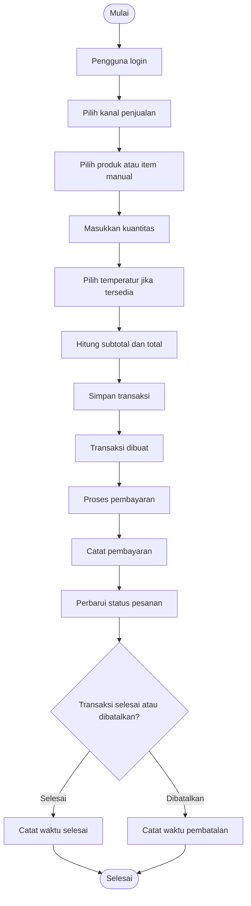

# Transaction Flow — LABOR_STATION

## 1. Overview

Dokumen ini menjelaskan alur transaksi pada sistem LABOR_STATION, mulai dari pemilihan produk hingga pencatatan pembayaran dan penyelesaian transaksi.

Sistem mendukung dua kanal penjualan:

- Offline
- GrabFood

Setiap transaksi menyimpan informasi pesanan, item produk, harga, kuantitas, subtotal, diskon, total, dan status transaksi.

## 2. Transaction Components

Transaksi terdiri dari beberapa komponen utama.

| Komponen | Keterangan |
|---|---|
| Invoice Number | Nomor unik transaksi |
| User | Pengguna yang membuat transaksi |
| Customer Name | Nama pelanggan, jika tersedia |
| Sales Channel | Kanal penjualan Offline atau GrabFood |
| Order Status | Status pesanan |
| Payment Status | Status pembayaran |
| Subtotal | Jumlah nilai item sebelum diskon |
| Discount | Nilai diskon |
| Total | Total transaksi setelah diskon |
| Transaction Items | Daftar item dalam transaksi |
| Payment | Informasi pembayaran |
| GrabFood Payout | Informasi pencairan dana GrabFood |

## 3. Transaction Flow Overview



Diagram tersebut menggambarkan alur umum transaksi. Detail validasi dan aturan perubahan status mengikuti implementasi backend.

## 4. Sales Channel

### 4.1 Offline

Transaksi Offline merupakan transaksi penjualan yang dilakukan secara langsung.

Karakteristik:

- Menggunakan kanal penjualan `OFFLINE`.
- Harga produk mengikuti data `product_prices` untuk kanal Offline.
- Item transaksi menyimpan snapshot nama produk dan harga saat transaksi dibuat.
- Pembayaran dicatat melalui data payment.

### 4.2 GrabFood

Transaksi GrabFood merupakan transaksi melalui kanal penjualan GrabFood.

Karakteristik:

- Menggunakan kanal penjualan GrabFood.
- Harga produk mengikuti harga untuk kanal penjualan terkait.
- Data transaksi dapat menyimpan potongan atau deduction dari platform.
- Sistem mencatat nilai bersih pencairan atau net payout.
- Status payout dan tanggal payout disimpan pada data transaksi.

## 5. Product Selection

Pengguna dapat menambahkan item ke dalam transaksi melalui dua jenis item.

### 5.1 Catalog Item

Catalog item merupakan produk yang berasal dari katalog produk LABOR_STATION.

Data item transaksi meliputi:

- `product_id`
- `product_name_snapshot`
- `unit_price`
- `quantity`
- `subtotal`

Nama produk dan harga disimpan sebagai snapshot agar informasi transaksi tetap tercatat sesuai kondisi saat transaksi dibuat.

### 5.2 Manual Item

Manual item merupakan item transaksi yang ditambahkan tanpa harus terhubung dengan produk katalog.

Karakteristik:

- `product_id` dapat bernilai NULL.
- `item_type` digunakan untuk membedakan jenis item.
- Nama item dan harga tetap dicatat dalam transaksi.

## 6. Product Temperature

Produk yang mendukung pilihan temperatur dapat menyediakan opsi:

- Hot
- Iced

Pilihan temperatur merupakan opsi penyajian pada produk yang sama, bukan produk baru dengan harga terpisah.

Alurnya:

1. Pengguna memilih produk.
2. Sistem menampilkan pilihan temperatur jika produk menyediakannya.
3. Pengguna memilih Hot atau Iced.
4. Pilihan temperatur disimpan pada kolom `temperature` di `transaction_items`.
5. Harga tetap mengikuti harga produk berdasarkan kanal penjualan.

Opsi temperatur yang tersedia pada produk disimpan melalui kolom `temperature_options`.

## 7. Transaction Calculation

Perhitungan transaksi menggunakan komponen berikut:

**Subtotal item**

```text
Subtotal Item = Harga Satuan × Kuantitas
```

**Subtotal transaksi**

```text
Subtotal Transaksi = Jumlah Seluruh Subtotal Item
```

**Total transaksi**

```text
Total = Subtotal Transaksi - Diskon
```

Nilai transaksi disimpan dalam kolom:

- `subtotal`
- `discount`
- `total`

Seluruh nilai uang disimpan menggunakan tipe bilangan bulat tanpa pecahan.

## 8. Transaction Status

Transaksi memiliki dua jenis status yang berbeda.

### 8.1 Order Status

Order status menunjukkan kondisi pesanan.

Nilai awal yang ditetapkan pada database adalah:

```text
NEW
```

Data transaksi juga menyediakan kolom:

- `completed_at`
- `cancelled_at`

Kolom tersebut digunakan untuk mencatat waktu penyelesaian atau pembatalan transaksi.

### 8.2 Payment Status

Payment status menunjukkan kondisi pembayaran.

Nilai awal yang ditetapkan pada database adalah:

```text
UNPAID
```

Informasi pembayaran disimpan pada tabel `payments`.

Order status dan payment status merupakan dua informasi terpisah sehingga perubahan status pesanan tidak boleh disamakan dengan status pembayaran.

## 9. Payment Flow

Pencatatan pembayaran dilakukan melalui endpoint:

```http
POST /api/transactions/{id}/payment
```

Alur umum:

1. Pengguna membuka transaksi.
2. Sistem menampilkan informasi total transaksi.
3. Pengguna melakukan proses pembayaran.
4. Sistem mencatat informasi pembayaran.
5. Informasi pembayaran disimpan pada tabel `payments`.
6. Status pembayaran transaksi diperbarui sesuai hasil proses pembayaran.

Data pembayaran meliputi:

- `transaction_id`
- `verified_by`
- `method`
- `amount`
- `reference_number`
- `paid_at`

Setiap transaksi memiliki maksimal satu record pembayaran berdasarkan constraint unique pada `transaction_id`.

## 10. Order Status Update

Pembaruan status pesanan dilakukan melalui endpoint:

```http
PATCH /api/transactions/{id}/status
```

Endpoint tersebut membutuhkan permission:

```text
transaction.status.update
```

Transaksi memiliki kolom status pesanan dan waktu penyelesaian atau pembatalan.

Aturan detail transisi status mengikuti implementasi `OrderStatusController`.

## 11. GrabFood Payout Flow

Sistem menyediakan pencatatan payout khusus untuk transaksi GrabFood.

Endpoint:

```http
POST /api/transactions/{id}/payout
```

Endpoint tersebut dibatasi menggunakan middleware:

```text
role:owner
```

Informasi payout yang tersedia pada tabel transaksi:

| Field | Keterangan |
|---|---|
| `platform_deduction` | Potongan dari platform |
| `net_payout` | Nilai bersih pencairan |
| `payout_status` | Status pencairan |
| `payout_date` | Tanggal pencairan |

Alur umum:

1. Owner memilih transaksi GrabFood.
2. Owner membuka informasi payout.
3. Sistem menyediakan pencatatan payout.
4. Informasi potongan dan nilai bersih pencairan dicatat.
5. Status serta tanggal payout disimpan pada transaksi.

## 12. Transaction Database Relationship

Transaksi menggunakan beberapa tabel database yang saling berhubungan.

| Tabel | Fungsi |
|---|---|
| `transactions` | Menyimpan informasi utama transaksi |
| `transaction_items` | Menyimpan item produk dalam transaksi |
| `products` | Menyimpan katalog produk |
| `product_prices` | Menyimpan harga produk berdasarkan kanal |
| `payments` | Menyimpan informasi pembayaran |
| `users` | Menyimpan pengguna yang membuat transaksi |

Hubungan utama:

- Satu transaksi dapat memiliki banyak transaction items.
- Satu produk dapat digunakan pada banyak transaction items.
- Transaction item dapat memiliki `product_id` NULL untuk item manual.
- Satu transaksi memiliki maksimal satu record payment berdasarkan constraint unique.

## 13. Audit and Data Integrity

Sistem menyediakan tabel `audit_logs` untuk mencatat aktivitas yang berkaitan dengan perubahan data.

Data audit dapat menyimpan:

- `user_id`
- `action`
- `entity_type`
- `entity_id`
- `metadata`
- `created_at`

Tabel audit log membantu menyediakan informasi aktivitas sistem dan mendukung proses penelusuran perubahan data.

## 14. Important Notes

- Kanal penjualan disimpan pada transaksi.
- Harga produk mengikuti kanal penjualan.
- Snapshot nama dan harga item disimpan pada transaksi.
- Item manual dapat dibuat tanpa relasi produk katalog.
- Pilihan temperatur disimpan pada item transaksi.
- Order status dan payment status merupakan dua status yang berbeda.
- Pencatatan payout GrabFood dibatasi untuk Owner.
- Detail transisi status dan validasi transaksi mengikuti implementasi controller backend.

## 15. Related Backend Components

Komponen backend yang berkaitan dengan alur transaksi:

| Component | Tanggung Jawab |
|---|---|
| `TransactionController` | Pengelolaan transaksi |
| `PaymentController` | Pencatatan pembayaran |
| `OrderStatusController` | Pembaruan status pesanan |
| `GrabFoodPayoutController` | Pengelolaan payout GrabFood |
| `Product` | Data produk |
| `ProductPrice` | Harga produk berdasarkan kanal |
| `Transaction` | Model transaksi |
| `TransactionItem` | Model item transaksi |
| `Payment` | Model pembayaran |

Dokumen ini disusun berdasarkan struktur database, definisi route API, dan komponen backend LABOR_STATION.